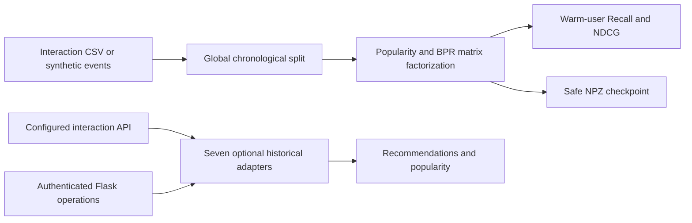

# Recommendation Model Lab

A recommendation engineering workbench that combines seven historical model adapters with a small, reproducible implicit-feedback baseline. The original system ingests user–item interactions, trains a selected recommender, and exposes recommendation and popularity operations through a Flask adapter. The portable experiment provides a separate, inspectable training and evaluation path without MongoDB, TensorFlow, external accounts, or private interaction logs.

This repository demonstrates model integration, candidate ranking, interaction ingestion, model persistence, and the practical difficulties of comparing recommendation frameworks. It includes both preserved experimental integrations and a tested NumPy implementation; their verification status is deliberately documented separately.

## Architecture



| Component | Responsibility |
| --- | --- |
| `recommender_lab.py` | Chronological splitting, train-only vocabularies, seeded BPR SGD, popularity baseline, evaluation, NPZ checkpoints |
| `classes/ModelTfrs.py` | TensorFlow Recommenders retrieval integration |
| `classes/ModelNCF.py` | Neural collaborative filtering experiment |
| `classes/ModelGMF.py` | Generalized matrix factorization experiment |
| `classes/ModelLightFM.py` | LightFM interaction-based recommendation integration |
| `classes/ModelFastai.py` | fastai collaborative filtering integration |
| `classes/ModelCollaborativeF.py` | Custom collaborative filtering implementation |
| `classes/NNHS.py` | Historical neural recommendation experiment |
| `fit.py`, `recom.py`, `popular.py` | Adapter dispatch and response construction |
| `app.py`, `config.py` | Loopback HTTP entry point and environment configuration |

The adapters retain their original training and serving code. They are optional research integrations, **not seven validated production models**. Framework compatibility, real-data metrics, and their older evaluation paths require separate work. See [internal engineering notes](docs/INTERNALS.md).

## Run the portable experiment

Python 3.11 or newer is recommended. Run from the repository root:

```bash
python -m venv .venv
```

Activate with `source .venv/bin/activate` on Linux/macOS or `.\.venv\Scripts\Activate.ps1` in PowerShell, then:

```bash
python -m pip install -r requirements.txt
python -m unittest discover -s tests -v
python recommender_lab.py --seeds 7 19 43 --epochs 30 --output artifacts/synthetic-benchmark.json
```

The default dataset is generated locally. No network access or credentials are needed. A real CSV can be supplied with `--csv interactions.csv`; its required columns are:

```csv
user_id,item_id,timestamp
demo-user-1,item-1,1700000001
demo-user-2,item-2,1700000002
demo-user-1,item-3,1700000003
```

This three-row fragment illustrates the schema; evaluation needs a larger interaction history with nonempty train, validation, and test partitions. Timestamps are integer values. Only use interaction data you are permitted to process.

## Measured synthetic baseline

The committed [raw report](artifacts/synthetic-benchmark.json) was generated with Python 3.14.2 and NumPy 2.4.0, 80 synthetic users, 120 possible items, 18 unique interactions per user, 16 latent factors, and 30 SGD epochs. Each seed produced 960 training, 240 validation, and 240 test events. The validation partition is reserved and is not used for tuning this report.

| Seed | Popularity Recall@10 | BPR Recall@10 | Popularity NDCG@10 | BPR NDCG@10 |
| --- | ---: | ---: | ---: | ---: |
| 7 | 0.0375 | 0.5125 | 0.0247 | 0.3349 |
| 19 | 0.0625 | 0.5083 | 0.0391 | 0.3314 |
| 43 | 0.0792 | 0.6083 | 0.0445 | 0.3979 |

These are results on a deliberately structured synthetic task. They do not measure commercial impact, real catalog quality, the seven legacy adapters, or generalization to a deployment. The evaluator excludes cold users, test-only items, and already-seen user–item pairs and reports the corresponding counts. Thus its ranking metrics describe the warm-user, known-catalog setting rather than cold-start performance.

## Legacy service

Use a separate environment for a selected framework; `requirements-adapters.txt` is a dependency inventory rather than a tested, universal lockfile. Several frameworks may need mutually incompatible versions or additional native tooling. The lightweight service and benchmark dependencies are in `requirements.txt`.

```bash
python app.py
curl http://127.0.0.1:5000/health
```

Importing the app and calling `/health` does not initialize a model or fetch interactions. Mutating/ranking operations use `POST /`, an `Authorization: Bearer` header containing the locally configured `MODEL_API_KEY`, and a JSON `act` of `fit`, `recom`, or `popular`. `fit` additionally requires the selected adapter's configuration and an interaction source. Request fields and model indices are described in [INTERNALS.md](docs/INTERNALS.md).

| Environment variable | Meaning / default |
| --- | --- |
| `MODEL_API_KEY` | Required for POST operations; empty disables them |
| `MODEL_API_HOST`, `MODEL_API_PORT` | `127.0.0.1`, `5000` |
| `INTERACTIONS_API_URL` | Approved paginated interaction source; empty by default |
| `INTERACTIONS_API_PAGE_SIZE` | Page size, `1000` |
| `INTERACTIONS_MONGO_URI` | Optional adapter-specific database URI; empty |
| `MODEL_ARTIFACT_DIR` | Local model directory, `artifacts/models` |
| `RECOMMENDATION_TOP_K` | Default candidate count, `10` |

The HTTP adapter serializes operations because the historical dispatcher uses shared model/request state. Training is synchronous, in-memory model state is process-local, and restart recovery is adapter-specific. This is a local engineering workbench; production use needs background training, versioned model registration, request validation for the chosen adapter, and a measured serving budget.

## Verification and publication scope

Offline tests exercise temporal boundaries, train-only vocabularies, seen-item filtering, reproducible optimization, safe checkpoint loading, cold-start accounting, and HTTP authentication boundaries. CI compiles every included Python source and runs the portable tests. It does not train external framework adapters or contact a live database.

Private interaction logs, credentials, trained weights, caches, and old local instructions are excluded. Documentation and operational instructions are in English. See [SECURITY.md](SECURITY.md) for configuration handling and [LICENSE](LICENSE) for usage terms.
